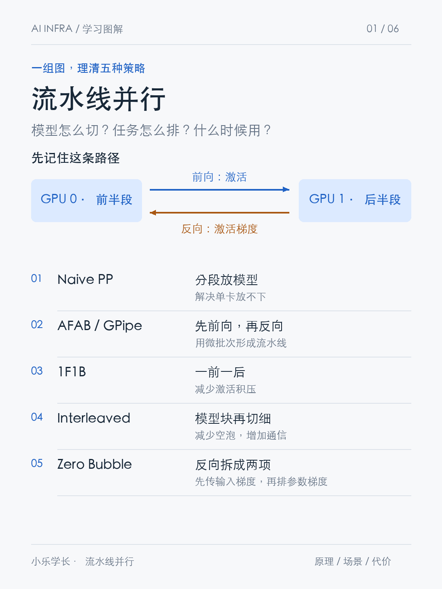
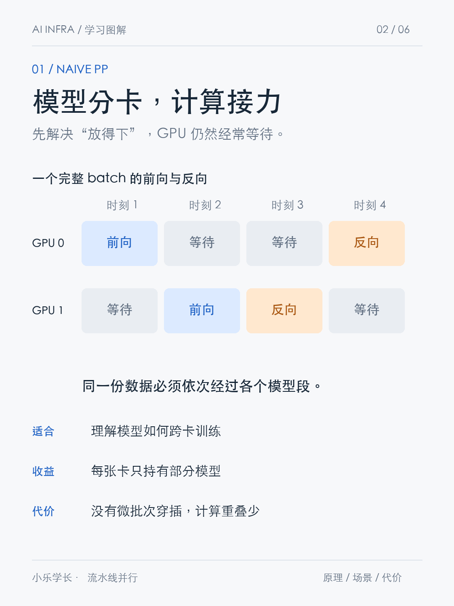
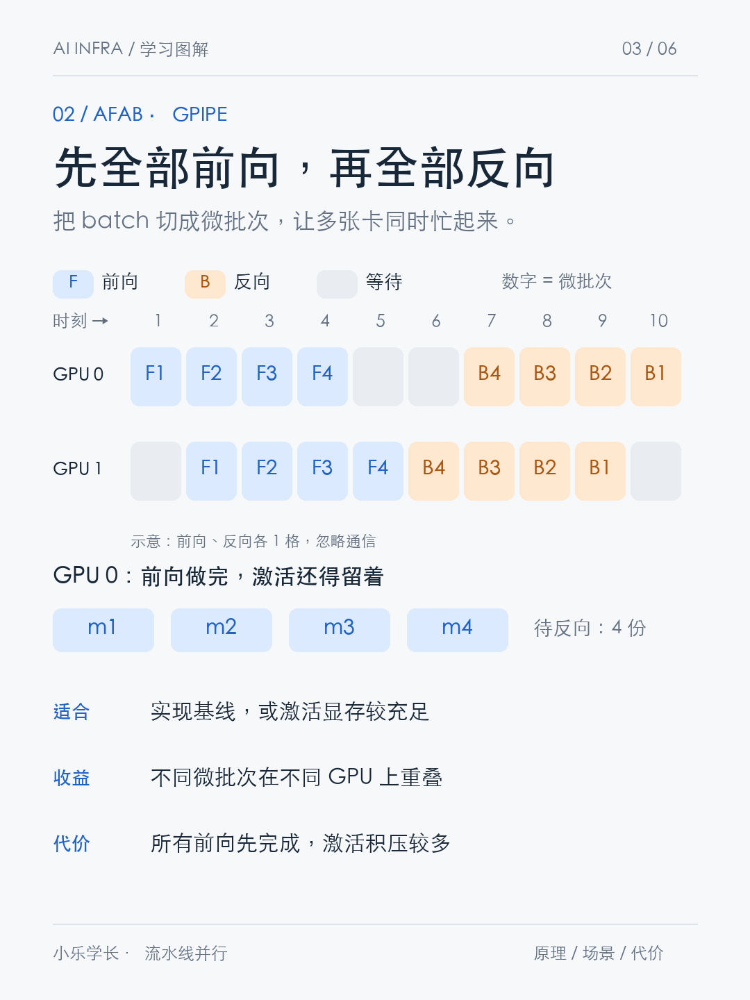
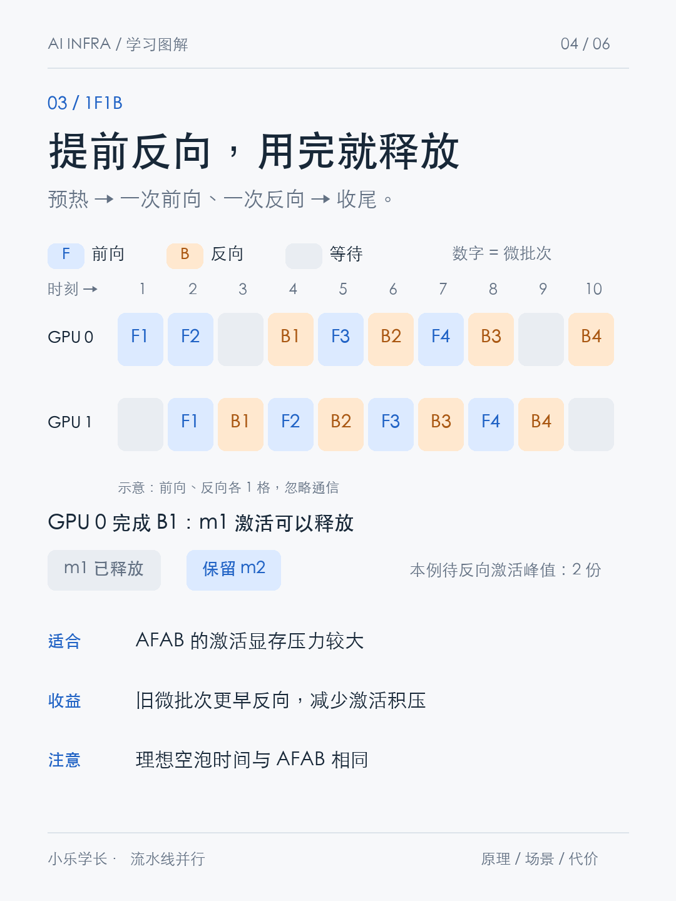
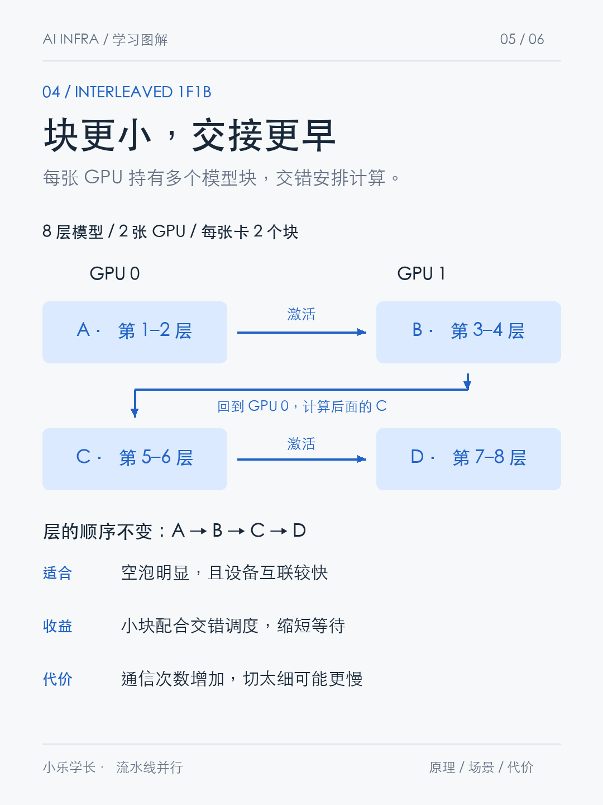
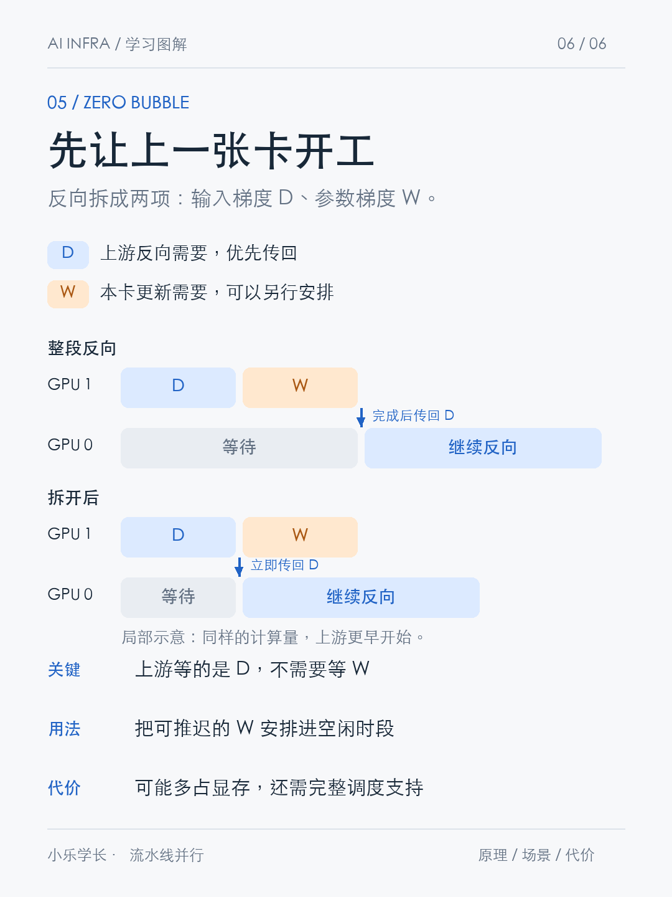

# 从 Naive PP 到 Zero Bubble：流水线并行详细笔记

> 本文围绕同一个问题展开：模型分到多张 GPU 后，怎样安排前向、反向和通信，才能兼顾显存与吞吐量？
>
> 内容基于 AIInfra《Pipeline 并行实践》、PyTorch 文档、Megatron 与 Zero Bubble 论文整理。时间线和代码片段用于解释原理，不代表已测试的生产实现。

## 目录

1. [先分清四个维度](#1-先分清四个维度)
2. [激活与梯度：跨卡到底传什么](#2-激活与梯度跨卡到底传什么)
3. [Naive PP：模型分段，计算接力](#3-naive-pp模型分段计算接力)
4. [AFAB / GPipe：先全部前向，再全部反向](#4-afab--gpipe先全部前向再全部反向)
5. [1F1B：提前反向，减少激活积压](#5-1f1b提前反向减少激活积压)
6. [Interleaved 1F1B：模型块切细，交错执行](#6-interleaved-1f1b模型块切细交错执行)
7. [Zero Bubble：把反向再拆成两部分](#7-zero-bubble把反向再拆成两部分)
8. [混合并行：DP、PP、TP 分别做什么](#8-混合并行dppptp-分别做什么)
9. [如何选择与验证](#9-如何选择与验证)
10. [原文代码阅读注意事项](#10-原文代码阅读注意事项)
11. [参考资料](#11-参考资料)

## 1. 先分清四个维度

| 维度 | 需要回答的问题 | 例子 |
|---|---|---|
| 模型划分 | 哪些层由哪个设备负责？ | GPU 0 放前半段，GPU 1 放后半段 |
| 数据划分 | 一个训练 batch 如何切成微批次？ | 32 条样本切成 4 份，每份 8 条 |
| 执行调度 | 每张卡先做哪个任务？ | AFAB、1F1B、Interleaved、Zero Bubble |
| 通信 | 当前任务依赖哪些跨卡数据？ | 前向接收激活，反向接收激活梯度 |

**PP 首先是一种按模型层分段的并行方式。仅完成分段，并不意味着已经实现高效流水线。**

### 1.1 本文统一使用的例子

模型先分为两段：

```text
输入 → GPU 0：前半段 → GPU 1：后半段 → loss
```

一个 batch 包含 32 条样本，切成 4 个微批次：m1、m2、m3、m4，每个 8 条。

- `F1`：当前模型阶段对 m1 做前向。
- `B1`：当前模型阶段对 m1 做完整反向。
- `·`：当前 GPU 没有执行图中所计的计算任务。

若无特别说明，时间线假设每个阶段耗时均衡、前向和完整反向各占一格，并忽略通信、数据加载及优化器开销。真实训练中，反向往往比前向更长。

### 1.2 单个微批次仍然有先后依赖

GPU 1 必须收到 GPU 0 的输出，才能继续处理同一个微批次。PP 的主要吞吐收益来自：**不同 GPU 同时处理不同微批次的不同模型阶段。**

单个微批次走完整个模型的延迟，不会因为流水线调度就自动按 GPU 数量缩短。



## 2. 激活与梯度：跨卡到底传什么

### 2.1 前向传的是激活

写成函数：

$$
h=f_0(x;W_0),\qquad y=f_1(h;W_1),\qquad L=\ell(y,t)
$$

- GPU 0 持有参数 $W_0$，计算中间结果 $h$。
- GPU 1 持有参数 $W_1$，把 $h$ 作为输入继续计算。
- $h$ 是阶段边界的激活。

激活是由当前输入和模型参数算出的中间结果，不是优化器直接更新的参数。每个微批次有自己的激活；同一个模型阶段的参数则由这些微批次共用。

### 2.2 反向传的是输入梯度，也叫边界激活梯度

```text
前向：GPU 0 ── h ─────────────→ GPU 1
反向：GPU 0 ←─ ∂L/∂h ───────── GPU 1
```

这里传回的是 $\partial L/\partial h$，不是 GPU 1 的参数梯度 $\partial L/\partial W_1$。

因为 $h$ 同时是 GPU 0 的输出、GPU 1 的输入，所以同一个梯度可以叫：

- GPU 1 的输入梯度；
- GPU 0 的输出梯度；
- 阶段边界的激活梯度。

它与 $h$ 的形状相同。若 $h$ 的形状是 `[micro_batch_size, sequence_length, hidden_size]`，对应梯度也具有这个形状。

### 2.3 为什么上一张 GPU 必须等这个梯度？

GPU 0 知道自己怎样生成 $h$，但不知道 $h$ 后面的运算怎样影响最终 loss。

它需要链式法则中的两部分：

$$
\frac{\partial L}{\partial W_0}
=
\left(\frac{\partial h}{\partial W_0}\right)^\top
\frac{\partial L}{\partial h}
$$

右侧第一部分由本地计算图决定，第二部分由 GPU 1 的反向计算提供。这里是向量—雅可比积的示意；框架通常不会显式构造完整雅可比矩阵。

看一个标量例子：

$$
x=3,\quad a=2,\quad h=ax=6,\quad b=4,\quad y=bh=24
$$

目标为 20，令：

$$
L=\frac12(y-20)^2
$$

GPU 1 计算并传回：

$$
\frac{\partial L}{\partial h}=(y-20)b=(24-20)\times4=16
$$

GPU 0 才能算出：

$$
\frac{\partial L}{\partial a}
=\frac{\partial L}{\partial h}\frac{\partial h}{\partial a}
=16\times3=48
$$

**GPU 0 自己知道“3”，但缺少后面传回的“16”，就算不出“48”。**

GPU 1 自己参数的梯度是：

$$
\frac{\partial L}{\partial b}=(y-20)h=4\times6=24
$$

GPU 0 不需要这个 24。这个区别正是理解 Zero Bubble 的关键。

### 2.4 为什么反向需要保存激活？

对线性层 $y=Wx$，记下游传来的梯度为 $g_y$：

$$
g_x=W^\top g_y,\qquad g_W=g_yx^\top
$$

计算输入梯度需要参数 $W$，计算参数梯度需要前向输入 $x$。其他算子可能需要输入、输出、掩码或其他中间数据。

因此，前向完成后，反向要用的数据必须仍然可用：通常是保存，也可以通过重计算重新获得。并非所有激活都必须原样保存，具体取决于算子和内存优化方式。

## 3. Naive PP：模型分段，计算接力



### 3.1 它做了什么

原文这一节标题使用 Native，代码类名是 `NaivePipelineParallel`。其基本流程是：

1. 调用者提供已经分好的模型段。
2. 使用 `nn.ModuleList` 注册这些子模块。
3. 将各段参数和缓冲区迁移到对应 GPU。
4. 整个 batch 依次通过各段，在边界复制激活。
5. 从最终 loss 发起反向。

`ModuleList` 管理子模块注册，不会自动调度流水线。模型如何切分，也不是这个容器决定的。

### 3.2 两卡数据路径

以下是独立的教学示例，需要支持 CUDA 的 PyTorch 环境和至少两张 GPU；本笔记未在双 GPU 环境运行验证。

```python
import torch
from torch import nn

left = nn.Linear(100, 64).to("cuda:0")
right = nn.Linear(64, 10).to("cuda:1")

batch = torch.randn(8, 100)
target = torch.randint(0, 10, (8,), device="cuda:1")

x0 = batch.to("cuda:0")
h0 = left(x0)
h1 = h0.to("cuda:1")
prediction = right(h1)

loss = nn.functional.cross_entropy(prediction, target)
loss.backward()

# left.weight.grad 在 cuda:0，right.weight.grad 在 cuda:1。
# backward 只计算、累积梯度；optimizer.step 才更新参数。
```

对这里正常记录梯度的浮点运算，跨设备 `.to()` 保留自动求导连接，复制操作的反向负责把对应梯度送回源设备。

### 3.3 几个容易混淆的操作

| 操作 | 含义 |
|---|---|
| `module.to(device)` | 迁移模块参数和缓冲区，修改模块本身 |
| `tensor.to(device)` | 返回目标设备上的张量；跨设备时是副本 |
| `requires_grad_(True)` | 设置张量需要梯度，不会恢复已切断的历史 |
| `retain_grad()` | 保留非叶子张量的梯度，方便之后读取 `.grad` |
| `detach()` | 断开当前张量与已有上游计算图的连接 |

只要 stage 参数需要梯度，在正常梯度记录模式下，其输出通常已经需要梯度。再对输出调用 `requires_grad_(True)` 通常是冗余的。

非叶子激活的 `.grad` 默认可能为 `None`，不代表梯度没有经过它；需要观察时，在反向前调用 `retain_grad()`。

把中间激活存进 Python 列表，只是保留引用，不会自动复制数据，也不会自动保留 `.grad`。反复覆盖一个 Python 变量，同样不会因此切断计算图。

### 3.4 为什么利用率低

```text
时间 →   1     2     3     4
GPU 0   前向   等待   等待   反向
GPU 1   等待   前向   反向   等待
```

当前 batch 有严格依赖，又没有其他微批次穿插。CUDA 的异步提交不会消除这种依赖。

**适用定位：** 理解跨卡训练、分摊模型存储，是后续调度的基础。

## 4. AFAB / GPipe：先全部前向，再全部反向



### 4.1 调度顺序

AFAB 是 All Forward, All Backward。一个 batch 的所有微批次先完成前向，再进入反向阶段。

```text
时间 →   1   2   3   4   5 │ 6   7   8   9  10
GPU 0   F1  F2  F3  F4   · │ ·  B4  B3  B2  B1
GPU 1    ·  F1  F2  F3  F4 │ B4 B3  B2  B1   ·
```

时刻 2，GPU 0 做 m2 的前半段，GPU 1 做 m1 的后半段。反向阶段也能在不同微批次之间重叠。

图中反向按 m4 到 m1 排列，是一种合法排法；AFAB 的定义并不要求微批次必须按这个顺序反向。GPipe 的完整方案还包括重计算等设计，这里聚焦其 AFAB 调度。

### 4.2 激活为什么积压

GPU 0 做完四个前向后，四个微批次都还没反向，需要保留各自反向所需的上下文。模型参数只有一份，激活则是四套。

在微批次大小固定、每份激活开销相近、没有重计算等优化的情况下，激活存储需求随微批次数增加。

### 4.3 梯度累积与更新

若四个微批次大小相等，且每份 loss 是其样本的平均值：

$$
L=\frac14\sum_{i=1}^{4}L_i,\qquad
\nabla_W L=\frac14\sum_{i=1}^{4}\nabla_W L_i
$$

因此各微批次可以分别反向，将正确缩放后的贡献累积到同一份参数梯度中。整个 batch 结束后更新一次。

- 微批次之间不清空梯度。
- 微批次之间不更新参数。
- 不等长微批次、变长序列和 token 级 loss，需要按实际样本数或有效 token 数做正确归一化，不能无条件除以微批次数。
- 若模型存在跨样本耦合的算子，例如某些 BatchNorm 用法，拆微批次可能改变计算语义，不能只靠 loss 缩放保证等价。

### 4.4 空泡的两种分母

设阶段数为 $P$，微批次数为 $M$，均衡阶段的单微批次前向、反向时间分别为 $t_f,t_b$。

理想计算时间和空泡开销的常用分析为：

$$
T_{ideal}=M(t_f+t_b),\qquad
T_{bubble}=(P-1)(t_f+t_b)
$$

两个比例不要混用：

$$
\frac{T_{bubble}}{T_{total}}=\frac{P-1}{M+P-1}
\quad\text{与}\quad
\frac{T_{bubble}}{T_{ideal}}=\frac{P-1}{M}
$$

前者是空泡占总时间的比例，后者是相对理想计算时间的额外开销。在两阶段、四微批次的示意中，前者为 $1/5=20\%$，后者为 $1/4=25\%$。

增加微批次数可以摊薄空泡，但固定 batch 下切得过小，可能导致矩阵计算效率下降、通信启动和调度开销突出。

## 5. 1F1B：提前反向，减少激活积压



### 5.1 不用等所有微批次的前向结束

最后一段完成 m1 的前向后，已经可以计算 m1 的 loss，并启动它的反向。后面微批次的前向不必全部完成。

本文讨论同步、每个 batch 排空后更新参数的普通非交错 1F1B。

```text
时间 →   1   2   3   4   5   6   7   8   9  10
GPU 0   F1  F2   ·  B1  F3  B2  F4  B3   ·  B4
GPU 1    ·  F1  B1  F2  B2  F3  B3  F4  B4   ·
```

F、B 通常对应不同微批次。1F1B 是执行顺序，不是要求一张 GPU 同时执行一个前向和一个反向。

### 5.2 三个调度时期

| 时期 | 做什么 | 为什么 |
|---|---|---|
| Warmup：预热 | 先执行若干前向 | 把数据送往下游，首批梯度尚未到达 |
| Steady state：稳定 | 交替执行前向、反向 | 推进新数据，同时处理旧数据的梯度 |
| Cooldown：收尾 | 完成剩余反向 | 没有新的前向任务，但仍有待反向任务 |

在上面的例子中，GPU 0 的局部顺序为：

```text
预热        稳定                         收尾
F1     |    F2 B1 → F3 B2 → F4 B3    |    B4
```

虽然开始时连续执行了 F1、F2，但按这一标准调度划分，预热只有 F1，F2 是稳定阶段第一组任务的前向。

不同 GPU 的预热长度不同，进入稳定、收尾的时刻也可以不同。这里的三个“时期”，不要与模型的 pipeline stage 混淆。

### 5.3 激活存活变化

只观察 GPU 0 已完成前向、尚未完成反向的微批次：

```text
F1 后：[m1]
F2 后：[m1, m2]
B1 后：[m2]
F3 后：[m2, m3]
B2 后：[m3]
F4 后：[m3, m4]
B3 后：[m4]
B4 后：[]
```

本例中，GPU 0 从 AFAB 的四套待反向激活，降到最多两套。这个计数不包含通信接收缓冲区、临时工作区等其他显存。

普通 1F1B 的待反向微批次数受流水线深度限制。当 $M\gg P$ 时，相比 AFAB 的激活存储收益明显。

### 5.4 单个阶段的调度伪代码

以下函数是抽象调度任务，不是可直接运行的 PyTorch API。各 GPU 并发执行自己的局部调度，函数内部必须处理通信、等待和上下文保存。

```python
# rank 从 0 开始；M 是微批次数，P 是阶段数。
warmup = min(P - rank - 1, M)

for micro_id in range(warmup):
    forward_one(micro_id)

for i in range(M - warmup):
    forward_one(warmup + i)
    backward_one(i)

for micro_id in range(M - warmup, M):
    backward_one(micro_id)
```

每个任务还需要对应的输入、输出、微批次编号和计算图。收到 m1 的梯度，必须匹配 m1 的前向上下文。

### 5.5 会不会发生 GPU 使用冲突？

同一张卡上的计算按调度顺序执行，不同卡可以处理不同方向的任务。

```text
时刻 5：GPU 0 前向 m3；GPU 1 反向 m2。
时刻 6：GPU 0 反向 m2；GPU 1 前向 m3。
```

参数在本次 batch 的前向、反向期间保持不变。不同微批次的激活分别保存，参数梯度按正确顺序累积。具体框架可以进一步重叠通信和计算，但那是额外的实现优化。

**普通同步 1F1B 的主要收益是激活显存。在前述理想分析下，它与 AFAB 的空泡时间相同。**

## 6. Interleaved 1F1B：模型块切细，交错执行



### 6.1 一张卡持有多个模型块

八层模型的两种分配方式：

| 方式 | GPU 0 | GPU 1 |
|---|---|---|
| 普通 PP | 第 1～4 层 | 第 5～8 层 |
| Interleaved，两个块/卡 | A：1～2 层；C：5～6 层 | B：3～4 层；D：7～8 层 |

模型顺序始终是：

```text
A → B → C → D
对应设备：GPU 0 → GPU 1 → GPU 0 → GPU 1
```

数据返回 GPU 0，是为了处理后面的 C，不是重算前面的 A。

这些块通常称为 model chunk 或虚拟流水线阶段。虚拟阶段增加，不等于新增物理 GPU。

### 6.2 调度器多了一个选择维度

原先需要选择：微批次编号、前向还是反向。

现在还要选择：当前 GPU 上的哪个模型块。

每个块的前向、反向仍在持有该块参数的设备上执行。参数与对应块绑定，激活上下文至少需要按“模型块＋微批次”区分。

### 6.3 不是多了一种填充、排空阶段

仍然有预热、稳定、收尾。增加的是逻辑块之间的计算与通信依赖。

```text
同一微批次前向：A → B → C → D
同一微批次反向：D → C → B → A
```

停止送入新的前向任务后，需要把所有块、所有微批次的待办反向完成。

每个块更小，第一次交接可以更早发生；但模型总计算量没有减少，第一个微批次完成整个模型的时间也不因此必然更短。最终空泡收益来自多个微批次与块的整体调度。

### 6.4 通信确实更多

在这个两卡例子中，假设边界张量大小相同：

| 每个微批次的跨卡传输 | 普通两段 PP | 四块 Interleaved |
|---|---:|---:|
| 前向激活 | 1 次 | 3 次 |
| 反向激活梯度 | 1 次 | 3 次 |
| 合计 | 2 次 | 6 次 |

模型块的层数减少，不意味着边界激活张量更小。例如 Transformer 中，边界的 batch、序列长度和 hidden size 可以保持不变。

因此要比较：

```text
减少的空泡时间
    与
新增且未被计算重叠隐藏的通信时间 + 调度开销
```

在均衡、忽略通信等理想条件下，每张卡分成 $v$ 个块，空泡时间可降为约：

$$
T_{bubble,interleaved}\approx\frac{(P-1)(t_f+t_b)}{v}
$$

这里 $t_f,t_b$ 是普通单阶段方案的基准耗时。**缩小到 $1/v$ 的是空泡开销，不是总训练时间。** 若按总时间计算空泡比例，同一理想模型下约为 $(P-1)/(Mv+P-1)$。

具体调度还可能限制微批次数与并行度的组合。例如原始 Megatron Interleaved 调度要求微批次数满足特定整除条件，不能假设所有实现都支持任意配置。

## 7. Zero Bubble：把反向再拆成两部分



### 7.1 没有发明新梯度，只是拆开本来就要做的工作

本文用 D 表示输入梯度计算，用 W 表示参数梯度计算。Zero Bubble 原论文使用 B、W；本文改用 D，是为了避免与前文“完整反向 B”混淆。

| 任务 | 线性层示例 | 结果供谁使用 |
|---|---|---|
| F：前向 | $y=Wx$ | 下一层 |
| D：输入梯度 | $g_x=W^\top g_y$ | 上一层继续反向 |
| W：参数梯度 | $g_W=g_yx^\top$ | 当前层的优化器 |

对于上游的反向路径，D 是直接依赖；本卡 W 的结果不在这条跨阶段依赖链上。

### 7.2 为什么可以先传 D

回到第 2 节的标量例子：

- GPU 1 的 D 结果是 16，GPU 0 必须拿到它，才能用 $16\times3$ 得到 48。
- GPU 1 自己的 W 结果是 24，GPU 0 的这个计算不需要它。

因此，若调度把 D、W 作为一个整体，并等整个任务完成才交回输入梯度，就会让上游等待不必要的本卡计算。

拆分之后，可以提前调度 D、交回梯度，并把 W 放在其他合适的位置。

### 7.3 局部时间线：先理解依赖变化

假设一个阶段的 D、W 各耗时一格，忽略通信；上游的完整反向耗时两格：

```text
完整反向作为一个任务，完成后交回梯度：
时间 →   1      2      3      4
GPU 1    D      W      ·      ·
GPU 0    等待   等待   反向   反向

拆开后，D 完成就交回：
时间 →   1      2      3      4
GPU 1    D      W      ·      ·
GPU 0    等待   反向   反向   完成
```

两个版本计算量相同，第二个版本让两张卡更早重叠。

**这只是局部依赖示意，不是完整 Zero Bubble 调度，也没有声称一个微批次就能消除所有空泡。** 普通框架底层可能存在不同的算子执行顺序；关键是把输入梯度与参数梯度计算暴露为可独立安排的任务。

### 7.4 完整 Zero Bubble 还做了什么

完整调度面对多个微批次，把可延后的 W 任务安排进原本等待 F 或 D 的位置。在阶段内部，W 仍需等待所需数据就绪，并满足框架的计算依赖。

对单个线性层，D 与 W 可共享已就绪的输入；但对由多层组成的阶段，不应据此认定“整个阶段任意 D、W 都可以无条件交换”。实际实现要保存各层参数梯度计算所需的上下文。

### 7.5 为什么可能更占显存

D 完成后，若 W 尚未执行，W 需要的输入激活、输出梯度等数据仍必须保留，或之后重计算。

```text
F：保存上下文
  ↓
D：输入梯度传回上游
  ↓
保留 W 尚需的数据
  ↓
W：计算并累积参数梯度
  ↓
相关数据不再被需要时释放
```

所以“D 完成”不等于“整个反向完成”，也不等于所有激活都能释放。

### 7.6 为什么不是开启后就一定零空泡

还需要考虑：

- F、D、W 的真实执行时长，并不总相同；
- 不同阶段的计算是否均衡；
- 微批次数是否足够；
- 显存是否允许保留更多上下文；
- 通信能否被重叠、是否产生额外等待；
- 梯度归约、梯度裁剪、溢出检查和优化器同步是否重新引入空泡。

原论文还研究了优化器同步的处理。不能把它简化成“算完一个微批次就随意更新参数”：完整方法需要维护所要求的同步训练语义。保守实现可以等所有梯度完成后更新，但这可能留下迭代边界的等待。

原始手工调度也展示了显存与空泡的不同取舍：同等显存约束下可以明显减少空泡，进一步放宽显存并满足条件后才能实现更激进的零空泡安排。

## 8. 混合并行：DP、PP、TP 分别做什么

### 8.1 DP＋PP：两条模型流水线处理不同数据

```text
模型副本 0：数据 X → GPU 0：A → GPU 2：B
模型副本 1：数据 Y → GPU 1：A → GPU 3：B

A 的 DP 同步组：GPU 0、GPU 1
B 的 DP 同步组：GPU 2、GPU 3
```

这里 $DP=2,PP=2$，使用四张 GPU。

每个模型副本共同持有完整模型，但单个 GPU 只持有其中一段。对应阶段的副本持有相同参数，处理不同数据。

### 8.2 两类梯度通信不要混淆

| 通信 | 例子 | 传什么 |
|---|---|---|
| PP 反向通信 | GPU 2 → GPU 0 | 边界激活梯度，让上游继续反向 |
| DP 梯度同步 | GPU 0 ↔ GPU 1 | 同一组参数在不同数据上的梯度贡献 |

只有对应参数的梯度才在 DP 副本之间归约。A、B 是不同模型段，不能把它们的参数梯度混在一起平均。

逻辑上应在参数更新前得到正确的全局梯度；实际实现可以按桶与反向重叠通信，不一定把所有归约都留到最后一次性执行。微批次累积期间的同步策略也需要框架正确控制。

### 8.3 全局 batch 大小

假设每条流水线处理相同数量、相同大小的微批次：

$$
B_{global}=DP\times M\times B_{micro}
$$

例如 $2\times4\times8=64$ 条样本。

PP 和 TP 不乘进数据样本数，因为它们合作处理的是同一份样本。

### 8.4 TP＋PP＋DP

TP 将层内的参数张量与计算划分给多个设备。忽略其他并行维度时：

$$
N_{GPU}=DP\times PP\times TP
$$

例如 $DP=2,PP=2,TP=2$ 使用八张卡，每条流水线有两个阶段，每个阶段由两张卡通过 TP 合作。

- DP：不同副本处理不同数据。
- PP：不同阶段处理不同模型层。
- TP：多个设备合作执行层内计算。

这些是模型与数据的组织方式；AFAB、1F1B 等是流水线的执行调度，二者可以组合。

### 8.5 原文 `DataParallel` 示例与上述结构有区别

原文 `HybridParallelModel` 把每个模型段包装成 `nn.DataParallel`，它的流程更接近：

```text
batch → 分发给 A 的副本 → 汇总 A 输出
      → 再分发给 B 的副本 → 汇总 B 输出
```

`DataParallel` 在前向复制模块、分发输入、汇总输出，在反向把副本梯度汇总到原始模块。

这不是“多进程中每个阶段用 DDP、各数据副本独立运行一条流水线”的相同执行结构。原文前向循环也没有实现微批次 1F1B 调度，因此应将它看作模型分段与数据并行的组合示例。

## 9. 如何选择与验证

### 9.1 策略对照

| 策略 | 改变了什么 | 主要收益 | 主要代价或限制 |
|---|---|---|---|
| Naive PP | 模型跨卡分段 | 分摊模型存储 | 缺乏微批次穿插，利用率低 |
| AFAB / GPipe | 多微批次先前向、后反向 | 形成流水线，逻辑清晰 | 激活积压，通常需关注重计算 |
| 普通 1F1B | 更早安排完整反向 | 减少待反向激活 | 理想空泡仍与 AFAB 相同 |
| Interleaved 1F1B | 每卡多个模型块，交错调度 | 缩短理想空泡 | 通信更多，调度和内存管理更复杂 |
| Zero Bubble | 拆分输入梯度、参数梯度计算 | 更细粒度地填补空闲 | 需要框架支持，并权衡显存和同步 |

### 9.2 按瓶颈选，而不是按名字选

1. 模型状态放不下：评估 PP 分段，以及 TP、优化器状态分片等手段。
2. AFAB 激活显存紧：评估普通 1F1B、激活重计算和微批次配置。
3. 空泡明显且互联较快：评估 Interleaved，实测通信增量。
4. 想进一步优化流水线空闲：在支持的框架中评估 Zero Bubble 类调度。

阶段划分要看实际耗时和显存，不只看层数。Embedding、输出头、不同层结构和序列长度都可能改变负载分布。

### 9.3 做正确性验证

- 从小模型、少量微批次开始，与基准的 loss、各阶段参数梯度和更新后的参数比较。
- 固定初始参数、数据和随机性；注意 dropout 等随机算子带来的比较差异。
- 检查所有应训练的阶段是否有正确的参数梯度，不能只看最终 loss 能否反向。
- 检查微批次 loss 的归一化，以及 DP 梯度归约是否引入重复缩放。
- 验证每个样本是否恰好经过完整模型一次，输出样本顺序是否匹配标签。

### 9.4 做性能验证

- 在相同模型、精度、全局 batch、序列长度和可比显存约束下比较。
- 先预热，再测量；CUDA 异步执行下，单看 Python 墙钟时间可能低估实际耗时。
- 记录 step time、样本或 token 吞吐、每卡峰值显存、阶段耗时和通信暴露时间。
- 用性能时间线确认 GPU 是否真正重叠计算，是否在发送、接收或同步处等待。
- 正确区分“激活缓存套数”“显存峰值”“空泡比例”“GPU 利用率”和“MFU”。

**空泡更少，不一定意味着端到端更快；更多通信、更小算子和更高显存压力，都可能抵消调度收益。**

## 10. 原文代码阅读注意事项

原文适合提供主题和实验框架，但不能把其中每个实现或数值直接作为正确基准。

### 10.1 阶段边界的 `detach()`

原文 GPipe 示例在边界使用 `detach().clone().requires_grad_(True)`。这创建了与原始上游历史断开的张量；重新打开梯度不会恢复连接。

手工切图并不是不允许，但必须保存上游原始输出，在拿到匹配的边界梯度后对正确的上游图发起反向。只保存 detached 张量再对它反向，不能驱动其已经断开的上游参数。

### 10.2 梯度形状不匹配不能靠随意 reshape 修复

边界梯度应与对应边界张量匹配。发现不匹配时，应检查阶段、微批次、张量来源和通信协议。形状能强行变换，不代表梯度语义正确；跳过梯度也不是有效修复。

### 10.3 有微批次循环，不等于有正确流水线调度

是否重叠取决于设备执行、复制和同步行为。Python 中出现多个循环，不能证明实现了 AFAB 或 1F1B 的目标时间线。

### 10.4 空泡率公式需要统一口径

原文对不同策略使用的公式混合了“空泡/总时间”和“空泡/理想计算时间”两种分母，不能直接放在同一列比较。

原文 Naive 分支返回 0，也不能据此解释成“Naive 没有设备空闲”。其时间线恰恰存在明显等待。

### 10.5 计时与训练结果必须独立核验

GPU 异步执行、阶段负载不均衡、随机数据、输出与标签对齐以及梯度链路问题，都可能使简单实验表格产生误导。

对运行时发现的错误，应追踪原因，不能靠裁剪标签、跳过梯度等方式让脚本表面跑通。

## 11. 参考资料

1. [AIInfra：CODE 03 Pipeline 并行实践](https://infrasys-ai.github.io/aiinfra-docs/04Train02ParallelAdv/Code03Pipeline.html)
2. [PyTorch：Pipeline Parallelism](https://docs.pytorch.org/docs/stable/distributed.pipelining.html)
3. [PyTorch：Tensor.to](https://docs.pytorch.org/docs/stable/generated/torch.Tensor.to.html)
4. [PyTorch：理解 requires_grad、retain_grad 与叶子张量](https://docs.pytorch.org/tutorials/beginner/understanding_leaf_vs_nonleaf_tutorial.html)
5. [PyTorch：DataParallel 源码](https://github.com/pytorch/pytorch/blob/main/torch/nn/parallel/data_parallel.py)
6. [NVIDIA：Scaling Language Model Training to a Trillion Parameters Using Megatron](https://developer.nvidia.com/blog/scaling-language-model-training-to-a-trillion-parameters-using-megatron/)
7. [Megatron：Parallelism Strategies Guide](https://docs.nvidia.com/megatron-core/developer-guide/latest/user-guide/parallelism-guide.html)
8. [Zero Bubble Pipeline Parallelism：论文](https://arxiv.org/html/2401.10241v1)
9. [Zero Bubble Pipeline Parallelism：实现](https://github.com/sail-sg/zero-bubble-pipeline-parallelism)

---

图片位于本文同级的 `xiaohongshu-pp-redesign/` 目录。分享 Markdown 时，保留该目录与本文的相对位置，即可继续显示图解。
